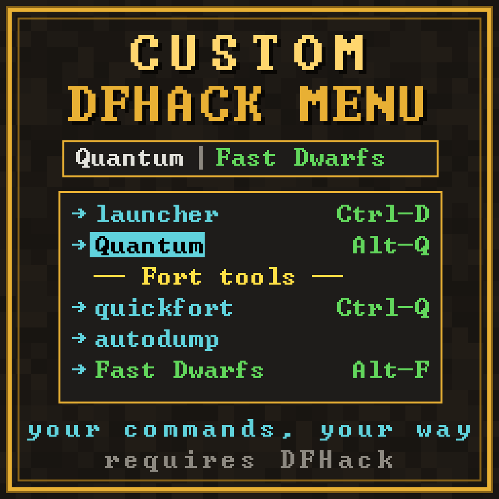
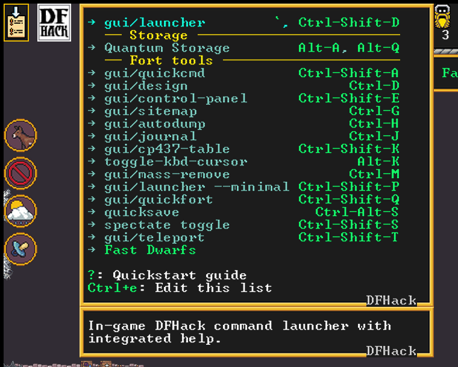
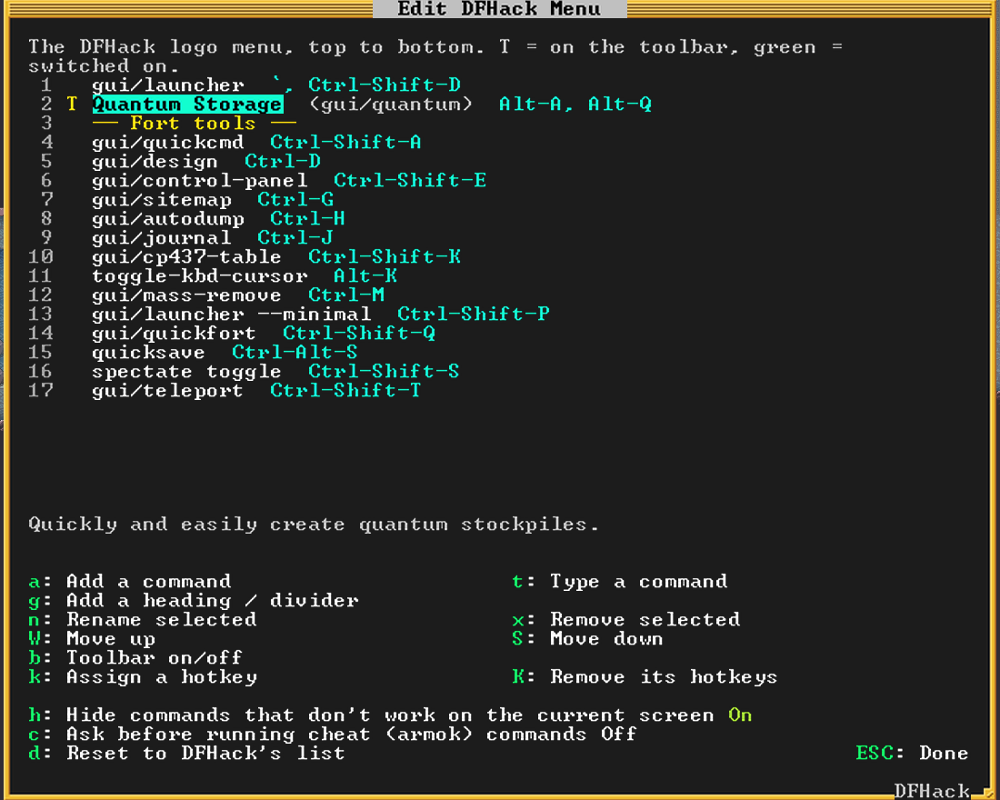
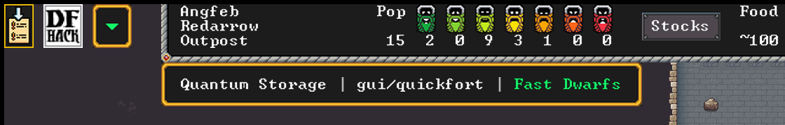
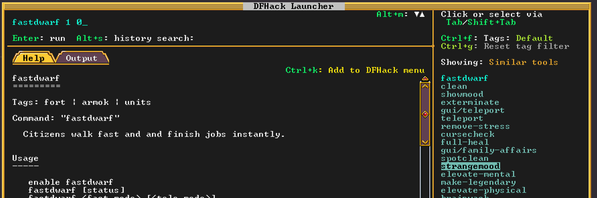

<p align="center">
  
</p>

<h1 align="center">Custom DFHack Menu</h1>

<p align="center"><b>Make the DFHack logo menu yours – and put your favourite commands on a toolbar.</b></p>

A [DFHack](https://store.steampowered.com/app/2346660/DFHack__Dwarf_Fortress_Modding_Engine/) mod for
Dwarf Fortress (Steam). Add any DFHack command to the logo menu (with or without a hotkey), remove the ones you
never use, put them in your own order, give them your own names, group them under headings, give them hotkeys,
and pin favourites to a toolbar under the top information bar.



## The menu

Click the DFHack logo as usual. The menu starts with the same commands DFHack shows, so nothing changes until
you edit it. Commands that have a hotkey show it; commands that can be switched on and off (like `fastdwarf`)
are **green while they're on**. Enter or click runs a command; right-arrow opens it in the launcher.

Press **Ctrl-E** in the menu (or run `custom-menu` in the launcher) to edit it.

## The editor



| Key | Action |
|---|---|
| `a` | Add a command from a searchable list of every DFHack command |
| `t` | Type a command line, including options (e.g. `gui/launcher --minimal`) |
| `g` | Add a heading (e.g. "Fort tools") or a plain divider line |
| `n` | Rename the selected command or heading |
| `x` | Remove the selected entry |
| `Shift-W` / `Shift-S` | Move it up / down |
| `b` | Put it on the toolbar (or take it off) – marked **T** |
| `k` | Assign a hotkey: press the shortcut you want (Ctrl and/or Alt + a key). You're warned if it's already used |
| `Shift-K` | Remove the hotkeys you assigned to it |
| `h` | Option: hide commands that don't work on the current screen (e.g. fort-only tools in adventure mode) |
| `c` | Option: ask before running cheat (armok) commands |
| `d` | Reset to DFHack's default list |

Changes are saved straight away to `dfhack-config/custom-menu.json`. Hotkeys you assign are saved in
`dfhack-config/init/dfhack.init` (marked with a comment), so they work everywhere, like DFHack's own.

## The toolbar



Commands marked for the toolbar get a button in a strip just under the top information bar. It grows and shrinks
to fit, wraps onto more rows when there are lots of buttons, and hides when there are none. Buttons for commands
that are switched on are green. Click a button to run its command.

The small arrow button next to the DFHack logo shows or hides the toolbar. The toolbar appears while you're playing
a fort or an adventure (not on the world map, embark screen or legends) – move it with `gui/overlay`
(`custom-menu.toolbar` in fort mode, `custom-menu.advtoolbar` in adventure mode).

## From the DFHack launcher



Type or run a command in the launcher (for example `fastdwarf 1 0`) and press **Ctrl-K** ("Add to DFHack menu").
A popup lets you give it a name, like *Fast dwarves*, and asks whether to put it on the toolbar too.

## Install

**Steam Workshop:** subscribe. There's no need to activate it in your mod list (it keeps itself out of the list) –
DFHack loads scripts from `scripts_modinstalled/` for any installed mod.

**Manual:** copy both files in `scripts_modinstalled/` (`custom-menu.lua` and its arrow image) into
`<Dwarf Fortress>/dfhack-config/scripts/`.

Requires DFHack.

## How it works

The DFHack logo opens its menu through the hotkeys plugin, which looks up its menu screen when you click. This
script points that at its own editable menu. No DFHack settings are changed, so removing the mod brings the
normal menu straight back. (Hotkeys you assigned stay in `dfhack.init` – remove them with `Shift-K` first, or
delete the marked lines.)

`custom-menu reset` in the launcher goes back to DFHack's default list.

## Workshop preview image

`preview.png` is the Workshop thumbnail (1024x1024, under Steam's 1 MB limit).
`tools/make_preview.py` can generate a simple pixel-art alternative using the game's own font:

```
python3 tools/make_preview.py "<Dwarf Fortress>/data/art/curses_800x600.png" preview.png
```

## Changelog

See [CHANGELOG.md](CHANGELOG.md).

## License

MIT – see [LICENSE](LICENSE).
